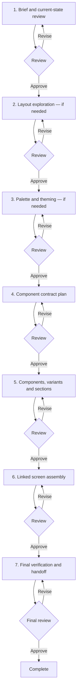

# Design System Workflow

**Build reusable components first. Assemble linked screens. Review each stage before moving on.**

`pankajvaghela/design-system-workflow` is an app-independent design workflow for AI agents. One orchestrator and six specialist skills guide the work from inspecting an existing design through layout exploration, palette and theming, component construction, screen assembly and verification.

It grew out of practical design work where duplicate components, broken variants and detached screens created avoidable rework. The workflow preserves approved decisions, keeps content separate from state, and checks actual component relationships alongside visual results.

These are agent instructions, not an editor integration. Your agent needs its own access to the design application. Editor capabilities determine which operations are possible; OpenPencil observations are included without assuming other tools behave the same way.

## Quick install (preferred)

Install all seven skills with the Skills CLI. This is the preferred route for Codex and Claude Code.

Requires Git and Node.js 22.20 or later. Run from the project where you want to use the workflow. These commands use Skills CLI **1.8.1**, the version verified for this release.

**Codex:**

```sh
npx skills@1.8.1 add pankajvaghela/design-system-workflow --skill '*' --agent codex
```

**Claude Code:**

```sh
npx skills@1.8.1 add pankajvaghela/design-system-workflow --skill '*' --agent claude-code
```

**Both:**

```sh
npx skills@1.8.1 add pankajvaghela/design-system-workflow --skill '*' --agent codex claude-code
```

Keep the quotes around `'*'`: it selects every skill in this repository. Install all seven together because the orchestrator and specialists reference one another. This installs skills into the current project; add `--global` only if you want them available across projects. Review any existing skills with the same names before accepting replacement. Avoid `--all`, which also selects every supported agent.

Check the installation:

```sh
npx skills@1.8.1 list --agent codex claude-code
```

You should see `design-workflow`, `design-foundations`, `design-components`, `design-assemble`, `design-consolidate`, `design-handoff`, and `design-verify`. Start with `design-workflow`; if the host has not refreshed its skill discovery, open a new session or invoke the installed `SKILL.md` by path.

This route installs portable skills, not a native plugin-directory listing. For Codex, the verified project location is `.agents/skills/`; Claude Code receives links in `.claude/skills/` to those same skill folders. The Skills CLI also creates a project lock file. See the [Skills CLI documentation](https://github.com/vercel-labs/skills) for other agents and options.

**Verified on November 15, 2026:** a clean temporary project installed all seven skills from the public GitHub repository for both Codex and Claude Code with Skills CLI 1.8.1 and Node.js 24.15.0. The CLI listed all seven for both hosts; installed content matched the sources and sibling/reference links resolved. The noninteractive test used `--yes`. Global installation, native plugin registration and a live agent/editor session were not tested.

Skills are discovered on [skills.sh](https://www.skills.sh/docs/faq) through users’ CLI installations with telemetry enabled; no separate directory submission is required. The installation test above used telemetry disabled.

## Install with your AI agent

Copy this prompt into your agent:

```text
Install the design-system-workflow plugin and its seven skills from:
https://github.com/pankajvaghela/design-system-workflow

Read the README and inspect the repository before making changes. Prefer its
verified all-seven-skills command for Codex or Claude Code. Detect this
agent host's supported plugin/skill installation mechanism and consult its
current official instructions. Use native plugin installation if supported;
otherwise install all seven skill folders together in a supported skill
location, preserving their relative links and reference files. Ask me for the
installation scope only if it cannot be determined from my environment.

Preserve unrelated configuration and existing skills. Report name conflicts
before replacing anything. Do not execute downloaded setup scripts or invent
unsupported installation commands.

Use design-workflow as the entry point. Keep explicit review gates enabled by
default; do not enable through-end continuation without my instruction.

Verify that all seven skills and their references are present and discoverable,
and tell me how to invoke the workflow in this host. If native registration or
discovery cannot be verified, say so and show how to invoke SKILL.md by path.
Do not begin editing a design as part of installation.
```

The repository includes a portable manifest at [`plugin.json`](plugin.json) and a matching Codex compatibility manifest at [`.codex-plugin/plugin.json`](.codex-plugin/plugin.json). Other agents can consume the portable `SKILL.md` files using their supported skill mechanism. Native plugin registration is host-specific; cloning the repository alone does not register it.

For manual use, clone the repository:

```sh
git clone https://github.com/pankajvaghela/design-system-workflow.git
```

Then ask your agent to read `skills/design-workflow/SKILL.md` from the clone. Keep all skill folders together so sibling references resolve. The default entry is a convention expressed by the orchestrator, specialist routing and plugin prompt metadata, not a universal host setting.

## Start a design task

After installation, ask:

```text
Use design-workflow to improve this screen. Inspect the current design and
existing library first. Reuse approved components, palette and themes.
Show the smallest relevant stage plan and wait for my explicit review after
each stage. Build reusable components before assembling final screens.
```

If your host supports dollar-prefixed skill invocation, use `$design-workflow`. Otherwise use the installed skill's path.

## The workflow

Only run stages relevant to the task. Existing approved work can eliminate stages. A small fix can be a single edit → verify → review stage.



The diagram shows the full route. Skip unnecessary stages rather than requesting empty approvals. Palette and theming can come before layout exploration when visual direction is needed to evaluate alternatives. Every applicable stage stops for review by default.

| Stage | Work | What you review at the stop |
| --- | --- | --- |
| **1. Brief and current state** | Inspect the actual document, requirements, existing components and constraints. | Scope, assumptions and the proposed route. |
| **2. Layout exploration** *(if needed)* | Explore hierarchy, navigation, density and screen structure with temporary parts. | Alternatives and the recommended direction. |
| **3. Palette and theming** *(if needed)* | Define semantic colors and required themes; reuse approved foundations and check contrast. | Palette roles, representative theme previews and check results. |
| **4. Component contract plan** | Identify sources to reuse or create, names, state properties, content slots and layout ownership. | Component inventory and variant plan. |
| **5. Components, variants and sections** | Build canonical controls, domain components and reusable sections; inspect linked specimens. | Real sources, representative content and required states. |
| **6. Linked screen assembly** | Assemble approved instances with the agreed spacing, content and state. | Complete screen previews and inspected source links. |
| **7. Final verification and handoff** | Check visual and structural results, persistence where possible, and implementation contracts when requested. | Final result, evidence, limitations and handoff if needed. |

At a review stop, the agent shows a concrete artifact, reports its checks, and asks **“Approve and continue, or revise?”** The final stage asks **“Approve this result, or revise?”** It does not start downstream work while waiting.

## Control the review gates

| Your instruction | What happens |
| --- | --- |
| “Continue” / “Approved” | Advance to the next stage, then stop for review. |
| Feedback without approval | Revise the current stage and present it again. |
| “Make these corrections, then continue” | Complete and verify the bounded corrections, then advance one stage. |
| “Continue until screen assembly” | Proceed through that stage with verification, then stop. |
| “Continue till the end with self-verification” | Complete the remaining agreed stages, checking each without intermediate pauses. |
| “Pause,” “wait,” or “review first” | Stop new work, restore review gates and cancel remaining continuation authorization. |

Silence and elapsed time never count as approval. Continued self-verification still stops for missing material decisions, unsafe failures or scope changes. Prior unchanged approvals persist across resumed sessions; revoked authorization does not.

## Included skills

| Skill | Responsibility |
| --- | --- |
| [design-workflow](skills/design-workflow/SKILL.md) | Default orchestrator: choose stages, manage review gates and resume from recorded approval state. |
| [design-foundations](skills/design-foundations/SKILL.md) | Palette, semantic colors, required themes and contrast evidence. |
| [design-components](skills/design-components/SKILL.md) | Reusable sources, properties, variants, content slots and component contracts. |
| [design-assemble](skills/design-assemble/SKILL.md) | Screens composed from linked instances with preserved layout and state. |
| [design-consolidate](skills/design-consolidate/SKILL.md) | Read-only audits and authorized migration away from duplicate sources. |
| [design-handoff](skills/design-handoff/SKILL.md) | Design/code mappings, token parity and accessibility contracts. |
| [design-verify](skills/design-verify/SKILL.md) | Visual and structural evidence, persistence checks and bounded recovery. |

Ordinary requests enter through the orchestrator. You can explicitly request an isolated specialist task, such as a read-only component audit. That exception does not authorize unrelated changes.

## Working principles

- Inspect the actual document before editing; reacquire identities on resume.
- Reuse approved visual identity and canonical sources before creating more.
- Keep content independent from state: bookmarking must not change the event or image.
- Use real components, variants and supported slots. Disclose unsupported capabilities.
- Check source links as well as screenshots. A named frame is not a component.
- Keep one writer per design document and preserve newer user changes during recovery.
- Report visual inspection, structural checks, saving, reopening and runtime behavior separately.

## Validation and contributions

The pack includes [behavioral scenarios](evaluations/scenarios.md) for review-gate behavior, state/content separation, migrations, recovery and theming. They are review fixtures, not an automated integration test suite.

When changing a skill, check its frontmatter and local links, exercise the affected scenario, and report what was observed versus assumed. Keep editor-specific behavior in reference notes. Native installation and live editor behavior must be verified in the target environment; static validation does not establish those claims.

The [source and adaptation map](skills/design-workflow/references/sources.md) credits the design-skill research behind the original synthesis. [OpenPencil notes](skills/design-workflow/references/openpencil.md) document observations from an early editing session, not a guaranteed API contract. Upstream scripts and manuals are not bundled.

## OpenAI submission package

The [submission preparation notes](submission/README.md) contain listing details, validation evidence, remaining portal steps and reproducible ZIP instructions. Preparing a bundle does not mean it has been submitted, approved or listed.

[Privacy policy](PRIVACY.md) · [Support](SUPPORT.md)

## License

[MIT](LICENSE) © 2026 Pankaj Vaghela.
